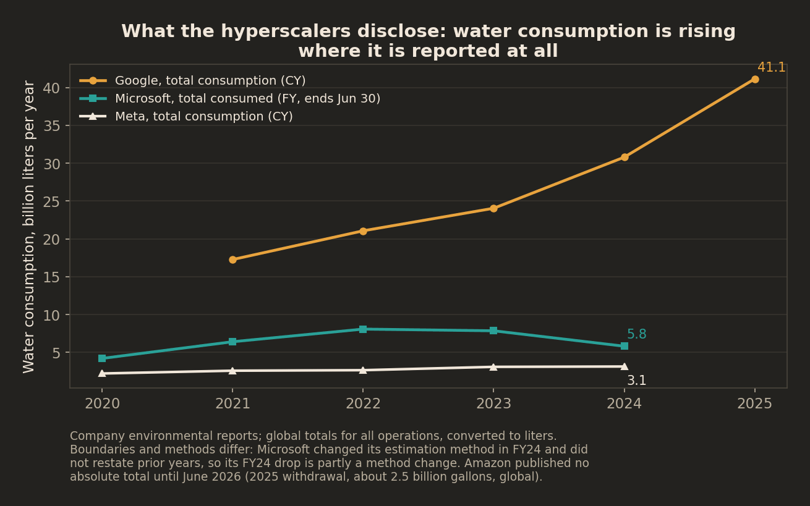
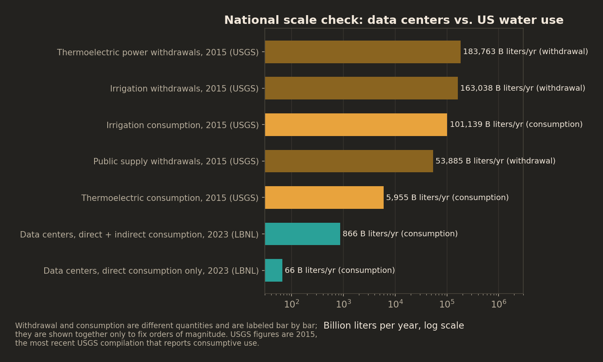
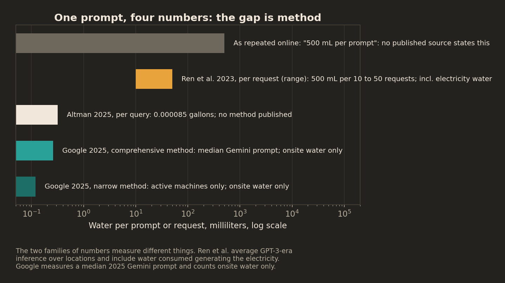

# Known vs. Asserted: What US Data Centers Actually Use

*Every public claim about data center water, sorted into three buckets: what is measured and disclosed, what is estimated by a credible body with a stated method, and what is asserted, repeated, and does not survive sourcing. National figures only, primary sources only.*

## The bottom line

US data centers used **176 TWh of electricity in 2023 (4.4% of the national total)** and **192 TWh in 2024 (4.7%)**, and consumed an estimated **66 billion liters of water onsite** in 2023. The electricity figures come from one modeled federal research program (Berkeley Lab, December 2024, updated June 2026), because the United States has no reporting mandate: almost nothing in this field is metered and published. What companies do disclose is rising fast. Google's total water consumption has grown every year it has reported, from 4,562 million gallons in 2021 to 10,869 million in 2025. And the number the public argues about most, the water cost of a single AI prompt, is the number with the least behind it: the viral version (500 mL per prompt) appears in no published source, while the only measured figure (0.26 mL, Google, August 2025) counts a narrower thing than the estimate it is compared against. The gap between bucket 1 and bucket 3 is the story, and it is a disclosure gap before it is a water gap.

## Finding 1: The growth is real, and the best numbers are modeled, not metered

Berkeley Lab's December 2024 report is the reference point for the national picture, and its June 2026 update (titled the 2025 Update) now extends it. US data center electricity use went from about 76 TWh in 2018 (1.9% of US electricity) to 176 TWh in 2023 (4.4%). The update adds 2024 at 192 TWh (4.7%), an increase it puts at 14% over its own revised 2023 estimate; the revision nudged its figures for earlier years slightly below the 2024 report's, on lower reported GPU shipments and revised AI inference assumptions, so the 2023 figure used here remains the 2024 report's. The 2024 result also lands at the low end of the range the 2024 report had projected for that year.

The forward look changed more than the history. The 2024 report gave a range for 2028, not a forecast: 325 to 580 TWh, or 6.7% to 12.0% of US electricity. That range is now superseded. The update's Reference Case, its central scenario, passes 464 TWh in 2028 and reaches 649 TWh in 2030, 11.8% of forecast US electricity, with data centers accounting for about a third of all US load growth between 2024 and 2030. Four sensitivity scenarios run from 578 to 782 TWh, and compounding the uncertainties gives a full 2030 range of 521 to 843 TWh (9.5% to 15.3%). A range whose top sits more than 60% above its bottom is the report being honest about how much depends on AI buildout decisions that have not been made yet.

The December 2024 report puts direct (onsite) water consumption at 21.2 billion liters in 2014 and 66 billion liters in 2023, with hyperscale and colocation facilities accounting for 84% of the 2023 total. For 2028 it projects hyperscale facilities alone at 60 to 124 billion liters. Indirect water, the water consumed generating the electricity data centers buy, is the bigger and quieter number: nearly 800 billion liters in 2023, at a national average intensity of 4.52 liters per kWh for data center electricity, close to the US grid average of 4.35. The June 2026 update contains no water estimates at all, so these remain the lab's most recent water figures (see Methods).

The counterweight, printed at the same size: efficiency kept improving while totals grew. The report's average power usage effectiveness (PUE) fell from 1.6 in 2014 to 1.4 in 2023. Google's fleet runs at a PUE of 1.09. The sector uses far more electricity and water than it did, and far less per unit of computing than it did. The June 2026 update projects the average PUE falling further, to 1.36 by 2030 in its Reference Case.

One classification note that matters for everything below: Berkeley Lab's figures are bucket 2. They are modeled estimates built from equipment shipments, surveys, and metered samples, by the most credible body working on the question, with the method published. They are not bucket 1. Nobody's meter readings add up to 176 TWh, because nobody is required to report them.

## Finding 2: What companies disclose, and what they do not

Three of the four hyperscalers publish absolute water totals. Read carefully, with the boundaries stated, because the boundaries are where these numbers mislead:

- **Google** reports the most: total water consumption by year, withdrawal and discharge, a data center subtotal, and per-site tables for large campuses. Total consumption rose from 4,562 million gallons (2021) to 8,135 million (2024) to 10,869 million (2025). Data centers alone consumed 7,787 million gallons in 2024 and 10,523 million in 2025. This is global, all operations.
- **Microsoft** reports total consumption and withdrawal for all operations in cubic meters: 5,807,000 cubic meters consumed in FY24, up from 4,196,000 in FY20. Its FY24 figure comes with a caveat Microsoft prints itself: the estimation method changed in FY24 and prior years were not restated, so the apparent FY24 drop in consumption is partly a ruler change, not a water saving.
- **Meta** reports withdrawal and consumption in megaliters: total consumption of 3,123 megaliters in 2024, of which data centers were 2,974. Meta is also the only one of the four that publishes the indirect figure: water embedded in its purchased electricity was 72,207 megaliters in 2024, roughly 24 times its data center direct consumption. That single disclosure is the best public evidence that the indirect bucket dwarfs the direct one.
- **Amazon** published no absolute total for years, only a water usage effectiveness ratio and a water-positive-by-2030 commitment. That changed in June 2026, when Amazon disclosed that its global data center footprint withdrew about 2.5 billion gallons in 2025, with a WUE of 0.12 L/kWh. Withdrawal, note, not consumption. The asymmetry the industry was criticized for is closing, one company and one definition at a time.

Efficiency ratios tell the same split story. Reported WUE for 2024-2025: Amazon 0.12 L/kWh, Meta data centers 0.19, Microsoft 0.30 (withdrawal basis, a 39% improvement since 2021). These are not measured the same way and should not be ranked as if they were.

Add the three 2024 totals that are published (Google, Microsoft, Meta) and you get about 10.5 billion gallons of consumption, global, all operations included. Berkeley Lab's estimate for US data centers alone, direct water only, is 17.4 billion gallons for 2023. The disclosed slice cannot be summed into a national total: it mixes years, borders, and boundaries, and it leaves out colocation, enterprise facilities, and every operator that publishes nothing. Anyone who adds company reports into a headline national number is manufacturing precision.

The direction of travel is toward less onsite water per facility. Microsoft's newest data center designs use chip-level cooling with no water evaporation for cooling, which the company says saves over 125,000 cubic meters per data center per year at its FY24 average intensity, and its newest AI facilities are designed to require no water for cooling. Amazon reports cooling with outside air about 90% of the time. Design claims are bucket 3 until the facilities report operating data; the trend in disclosed totals, bucket 1, is what to watch.

## Finding 3: The scale check cuts both ways

USGS's 2015 compilation, the most recent that reports consumptive use nationally, puts total US withdrawals at 322 billion gallons per day. Thermoelectric power withdrew 133 (41%) and irrigation 118 (37%). Against that denominator, Berkeley Lab's 66 billion liters of direct data center consumption in 2023 is about 17.4 billion gallons a year, roughly 0.015% of total withdrawals. That comparison mixes a consumption figure with a withdrawal total, and it is labeled that way here and on the chart; used carefully, it fixes the order of magnitude.

Consumption against consumption is less comforting for the industry and still not alarming at national scale. Irrigation consumed 73.2 billion gallons per day in 2015; data centers, direct plus indirect, consumed about 866 billion liters in 2023, around 0.63 billion gallons per day, roughly 15% of what thermoelectric generation itself consumed (4.31 billion gallons per day in 2015). The honest summary: nationally, data centers are a small and fast-growing water user whose largest footprint is the electricity it buys, and national averages say nothing about any individual watershed. This brief is national by design; the local question is a different brief, and it cannot be answered with national data.

## Finding 4: The per-prompt fight is a methods fight, and the viral number is a mutation

The most repeated water claim in the AI debate traces to a real paper. Ren and colleagues (2023) estimated that GPT-3 inference consumes a 500 mL bottle of water for roughly every 10 to 50 requests, counting onsite water plus the water consumed generating the electricity, varying by location and time. Implied per request: 10 to 50 mL. As the claim travels, the denominator falls off, and it becomes "500 mL per prompt." No published source states that. It is bucket 3: a bucket-2 estimate with its conditions stripped.

Against it, Google published the first measured per-prompt figure in August 2025: a median Gemini Apps text prompt in May 2025 used 0.24 Wh of energy and 0.26 mL of water under its comprehensive method (0.12 mL under the narrower method the industry used before). Google's water counts onsite consumption only, computed from energy at a fleet WUE of 1.15 L/kWh; it excludes electricity-generation water, which is most of what Ren counted. Sam Altman had put ChatGPT at about 0.34 Wh and 0.000085 gallons (0.32 mL) per query in June 2025, with no methodology published. Epoch AI, independently modeling GPT-4o energy, landed at about 0.3 Wh per query and published no water figure at all.

Read as a methods comparison rather than a verdict: the measured 2025 median for one operator's text prompts is two orders of magnitude below a 2023 academic average for a different model family that counted a wider boundary. Both can be internally sound. Neither licenses the number that actually circulates. The correction also has a correction: a median prompt is not a long reasoning session, an image generation, or an agent run, and Google's figure says nothing about those.

## Finding 5: The clearest cost so far is not water. It is capacity, and it lands on other people's bills

In PJM, the largest US grid, the 2025/2026 capacity auction cleared at $269.92 per MW-day for most of the footprint, up from $28.92 the year before, a 9.3x jump that flows into retail electricity bills across 13 states. PJM's own announcement spread the causes: fewer supply offers as generators retired, higher projected peak load, and market rule reforms.

The Independent Market Monitor's counterfactual (Part G, June 2025) isolates the data center share. Actual auction revenues were $14.69 billion. Remove only the forecast data center load and revenues fall to $6.94 billion. Remove existing plus forecast data center load and they fall to $5.35 billion. On the monitor's model, data center load accounts for $9.33 billion of the $14.69 billion, and about 83% of that increment is load that does not exist yet: capacity being bought, and paid for by all customers, against forecasts. That split, forecast vs. existing, is the policy-relevant number in this entire brief, and it is bucket 2: a careful model by the market's own monitor, not a measurement. The 2026/2027 auction then cleared at the FERC-approved cap of $329.17 per MW-day, and in September 2026 FERC suspended PJM's proposed backstop procurement for more capacity while it examines how the costs would be divided. Who pays for forecast load is now an open federal question.

## Finding 6: Europe made it a reporting rule. The US has not.

Since 2024, the EU's recast Energy Efficiency Directive has required data centers with IT power demand of 500 kW or more to report energy consumption, PUE, WUE, total water input, renewable share, and waste heat reuse to a European database, annually. The first cycle was partial: about 770 sites reported, roughly 36% of the facilities estimated to be in scope. Even a mandate starts as bucket 2. But the direction is set: European totals will become more measured every year, and the September 2026 proposal to turn the reported data into public A-to-G labels would make them comparable.

The United States has no equivalent federal requirement. Every US number in this brief exists because a company volunteered it or a national lab modeled it. What that looks like at ground level: when Google expanded in The Dalles, Oregon, the city sued a newspaper for 13 months to keep Google's water use secret as a trade secret, before dropping the case in December 2022 and releasing records showing 274.5 million gallons consumed in 2021. Google now publishes that site's water use in its annual report (361.4 million gallons consumed in 2024). Secrecy was the default; disclosure arrived by lawsuit, then became routine. That sequence, not any single gallon figure, is the finding.

## What this does not prove

Nothing here measures local impact. Water stress is watershed-specific, seasonal, and about timing as much as volume; a national brief cannot say whether any specific facility is a problem, and this one does not try. Company totals are global and mix data centers with offices unless a table says otherwise; fiscal and calendar years differ; Microsoft changed its estimation method in FY24 without restating history; Google's per-prompt figure is a median for text prompts at one operator in one month. USGS context is from 2015 because that is the last compilation with a national consumptive-use split. The PJM attribution is a counterfactual model: it shows what the auction would have cleared without data center load, holding everything else constant, and everything else was not constant. Finally, absence of disclosure is not evidence of high use, and disclosure is not evidence of low impact. It is evidence of measurability, which is the thing this brief is actually about.

## Methods

Scope is national aggregates for the United States, plus global company totals where that is the boundary companies report (labeled at every use). Primary sources only: the Berkeley Lab reports (December 2024 and the June 2026 update), company environmental reports and disclosures, the USGS water use compilation, the PJM auction results and the Independent Market Monitor's Part G analysis, the EU delegated regulation and Commission assessment, and the two per-prompt papers plus the operator statements they cite. Water figures are the December 2024 report's throughout: the June 2026 update revises the electricity history and outlook but publishes no water-use estimates, so the December 2024 report remains the most recent LBNL water assessment. Every figure was transcribed from the document itself; values, units as printed, document locations, and conversion factors are in `data/sources.md`, and headline figures with source keys are in `data/stats.json`. Conversions use 1 US gallon = 3.78541 liters. Withdrawal and consumption, direct and indirect, are never combined in a single figure without both labels. Where a number could not be verified to a primary source, it was dropped; the dropped list, with reasons, is at the end of `data/sources.md`.

## Data sources

- Lawrence Berkeley National Laboratory, "2024 United States Data Center Energy Usage Report", December 2024 (LBNL-2001637)
- Lawrence Berkeley National Laboratory, "United States Data Center Energy Usage Report: 2025 Update", June 2026 (LBNL-2001758)
- Google, "Environmental Report 2025" and "Environmental Report 2026"
- Microsoft, "2025 Environmental Sustainability Report" (FY24)
- Meta, "2025 Environmental Data Index" (CY2024)
- Amazon, "How Amazon is making its data centers more water-efficient", June 2026
- US Geological Survey, "Estimated Use of Water in the United States in 2015", Circular 1441
- Google, "Measuring the environmental impact of AI inference at Google scale", August 2025 (arXiv:2508.15734)
- Ren et al., "Making AI Less Thirsty", 2023 (arXiv:2304.03271); Epoch AI, "How much energy does ChatGPT use?", February 2025
- PJM Interconnection, 2025/2026 Base Residual Auction results, July 2024; Monitoring Analytics, "Analysis of the 2025/2026 RPM Base Residual Auction, Part G Revised", June 2025
- Directive (EU) 2023/1791 and Commission Delegated Regulation (EU) 2024/1364; European Commission first-cycle reporting assessment, 2026

## Reproduce

1. Read `data/sources.md` for the document, page, and unit behind every figure
2. Run `python code/charts.py` to regenerate all charts and the hero graphic into `charts/`
3. Check any figure against `data/stats.json`, which carries the same values keyed to their sources

Requires Python 3 with matplotlib and numpy.
